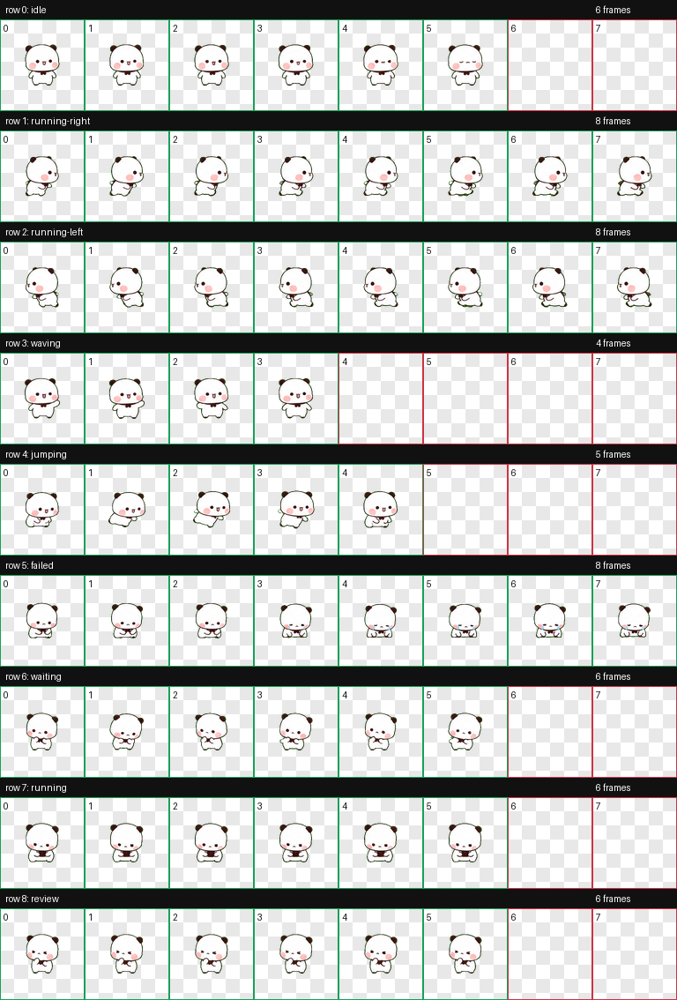

# YierPet 一二桌宠（Windows + Codex）

这是「一二」桌宠的 Windows 移植版，也提供可由 **Codex Desktop** 直接加载的原生自定义宠物包。

Windows 版现已加入布布：两只独立活动，支持跟随、招呼、专用抱抱/依偎动画。使用方法见 [Windows 双角色说明](windows/README.md#双角色互动)。本次变化不涉及 Codex 原生宠物包。

支持上传 GIF / PNG、编辑动作说明、配置多个联动候选与左右站位，并选择右键菜单入口。见 [表情编辑使用说明](docs/user-sticker-library.md) 和 [开发与目录说明](docs/development.md)。

已加入用户指定公众号文章的 492 项原表情素材库，支持完整动画预览、双人关联、按编号停用与恢复；使用入口和验证记录见 [原表情素材说明](content/wechat/README.md)。

另已补入 GetStickerPack 的 30 张原图。移动改用用户指定的 wx-0150（一二）、wx-0183（布布），生成跑步已退出使用。522 张原表情均有[逐项动作与回应说明](docs/art-direction/sticker-semantics.md)，114 组已接入独立窗口同步互动。两只仍可独立播放，闲置行为间隔约 4–8 秒。

> 本 README 面向 Windows 用户。仓库保留的 Swift/AppKit 文件是上游 macOS 实现的历史来源，仅供参考；在 Windows 上请不要运行 `build.sh`，而应使用 `windows\build-windows.ps1`。

## 选择使用方式

| 方式 | 适合场景 | 启动/安装 | 主要功能 |
| --- | --- | --- | --- |
| **Windows 独立桌宠** | 想要可拖拽、可抛掷、会弹出提醒的桌面小组件 | 构建并运行 `YierPet.Windows.exe` | 双角色交互、原表情库、自定义表情与健康提醒 |
| **Codex 原生宠物** | 希望一二出现在 Codex 的“宠物”设置中 | 复制宠物包到 Codex 目录并选择 | Codex 控制的标准动画状态与朝向显示 |

两者不是同一个程序：**Windows 独立桌宠不会自动与 Codex 联动**。要在 Codex 中使用一二，请按“在 Codex 中使用一二”的步骤安装原生宠物包。

## Windows 独立桌宠

### 环境要求

- Windows 10 或 Windows 11（x64）
- .NET 8 SDK（从源码构建时需要）

### 推荐安装

首次安装时在仓库根目录执行：

~~~powershell
.\windows\install-windows.ps1
~~~

安装脚本会把程序发布到 `%LOCALAPPDATA%\Programs\YierPet-Windows`，并自动完成：

- 在桌面创建“一二桌宠”快捷方式，之后可直接双击启动。
- 在 Windows“启动”文件夹创建快捷方式，实现登录后自动启动。
- 关闭已有的 Windows 独立桌宠实例并启动刚安装的最新版本。

程序使用框架依赖发布方式，因此目标电脑需要安装 .NET 8 Desktop Runtime；从源码执行安装脚本时，.NET 8 SDK 已包含所需运行环境。

### 正确启动

克隆本仓库后，在仓库根目录执行：

~~~powershell
git clone https://github.com/sduwcdd/YierPet-Windows.git
cd YierPet-Windows
.\windows\build-windows.ps1
& .\windows\YierPet.Windows\bin\Release\net8.0-windows\YierPet.Windows.exe
~~~

也可以一条命令构建并运行：

~~~powershell
.\windows\build-windows.ps1 -Run
~~~

`-Run` 会先关闭已有的 Windows 独立桌宠实例，再构建并启动最新的 Release 版本，避免旧 Debug 版本继续显示。它不会关闭 Codex 自身显示的原生宠物。

程序默认出现在主屏幕工作区的右下角附近。它没有任务栏图标；请对桌宠右键并选择“退出”来关闭。

若构建提示 `YierPet.Windows.exe` 正被占用，说明此前启动的桌宠尚未退出。请先右键现有桌宠并选择“退出”，再重新构建。若桌宠不可见但确认仍在运行，可在 PowerShell 中仅结束该进程后重试：

~~~powershell
Get-Process YierPet.Windows -ErrorAction SilentlyContinue | Stop-Process
~~~

### 生成可分发版本

下面的命令生成面向 `win-x64` 的自包含发布目录，入口为 `windows\artifacts\win-x64\YierPet.Windows.exe`：

~~~powershell
.\windows\build-windows.ps1 -Publish
~~~

自包含发布在构建时需要下载 Windows 运行时组件；发布后的目标电脑无需安装 .NET。请分发整个 `win-x64` 文件夹，包括 `Content` 和 `Assets`，不能只复制 EXE。

### 操作方式

| 操作 | 效果 |
| --- | --- |
| 左键单击 | 挥手打招呼 |
| 左键拖拽 | 移动桌宠，并按拖动方向播放奔跑动画 |
| 快速甩出 | 触发重力、撞墙/落地反弹和受击反馈 |
| 右键 | 打开菜单：切换动作、暂停随机行为、设置提醒、退出 |
| Alt + 右键 | 在菜单中显示“测试提醒”，可立即预览每种提醒 |

### Windows 版功能

| 类别 | 已实现功能 |
| --- | --- |
| 显示与动画 | 透明无边框、始终置顶、无任务栏图标；站立、原图左右走路及可配置的常用表情 |
| 自主行为 | 两位各自每隔约 4–8 秒尝试随机动作；用户操作和双人互动优先，走到主屏幕边缘会折返 |
| 交互 | 拖拽、抛掷物理、单击挥手、右键动作菜单 |
| 健康提醒 | 久坐、喝水、深夜关怀，以及已知视频播放器持续前台时的“摸鱼检测” |
| 表情编辑 | [上传 GIF / PNG、编辑关联与左右站位、自选右键菜单入口](docs/user-sticker-library.md) |
| 设置保存 | 随机行为和各类提醒开关保存在 `%APPDATA%\YierPet-Windows\settings.json` |

独立版只使用本机输入空闲时长、前台进程名；不会录屏，也不会读取浏览器页面内容。因此“摸鱼检测”只识别已知的视频播放器进程（如 VLC、PotPlayer、腾讯视频、爱奇艺、哔哩哔哩），不会判断浏览器中的具体网站。

## 在 Codex 中使用一二

### 1. 安装宠物包

将仓库中的整个 [`codex-pet/yier`](codex-pet/yier) 文件夹复制到 Codex 的自定义宠物目录，最终目录必须同时包含以下文件：

~~~text
C:\Users\<你的 Windows 用户名>\.codex\pets\yier\
├── pet.json
└── spritesheet.png
~~~

PowerShell 示例：

~~~powershell
$destination = Join-Path $env:USERPROFILE '.codex\pets\yier'
New-Item -ItemType Directory -Force $destination | Out-Null
Copy-Item .\codex-pet\yier\pet.json, .\codex-pet\yier\spritesheet.png -Destination $destination -Force
~~~

### 2. 在设置中选择

1. 打开 Codex Desktop 的“设置 → 宠物”。
2. 滚动到“自定义宠物”区域。
3. 找到“一二”，点击“选择”。
4. 若刚复制后未出现，先切换到其他设置页再返回；仍未出现时，完全退出并重新打开 Codex。

### Codex 中的功能边界

Codex 包是符合 v2 规格的原生宠物资源：图集为透明 `1536 × 2288` 像素、8 列 × 11 行，且含 Codex 所需的清单文件。选择后，**Codex 负责**调用标准动作与朝向行为，一二无需另行运行 `.exe`。

| 在 Codex 中可用 | 不属于 Codex 宠物包的功能 |
| --- | --- |
| Codex 的宠物选择、显示、标准动画状态和看向不同方向的行为 | 鼠标拖拽、抛掷物理、右键菜单 |
| 一二的待机、奔跑、挥手、跳跃、沮丧、等待、工作中、审阅等动作素材 | 久坐、喝水、深夜、视频播放器提醒 |
| 由 Codex 自身决定何时切换宠物状态 | Windows 独立版的本地设置文件与提醒开关 |

当前包复用了原始九种动作来填充 v2 的 16 个方向帧，因此可以被 Codex 正确识别并随方向切换；但上下、斜向并非单独绘制的专用姿势，视觉变化会少于 Codex 内置宠物。Codex 对宠物状态的具体触发时机由应用本身控制，宠物包只提供图像和元数据。

## 项目结构

~~~text
YierPet/
├── windows/
│   ├── build-windows.ps1             # Windows 构建、运行与发布脚本
│   └── YierPet.Windows/              # .NET 8 WPF 独立桌宠
├── codex-pet/
│   └── yier/                         # Codex v2 原生宠物包
│       ├── pet.json
│       └── spritesheet.png
├── content/wechat/                   # 原文件、运行图集、语义和互动清单
├── tools/                            # 素材导入、审阅、只读校验
├── docs/                             # 使用说明、开发结构与设计记录
└── Sources/                          # 上游 macOS Swift 实现（历史参考）
~~~

## 常见问题

**Q：Windows 桌宠和 Codex 会自动联动吗？**

不会。Windows 桌宠是独立的 WPF 程序；Codex 联动使用 `codex-pet/yier` 中的原生宠物包。

**Q：为什么 Windows 桌宠启动后任务栏里没有图标？**

这是设计行为。它以桌宠形式浮在屏幕上，请在桌宠上右键选择“退出”。

**Q：Codex 设置里看不到“一二”？**

检查目录是否精确为 `.codex\pets\yier`，且其中同时存在 `pet.json` 和 `spritesheet.png`；然后返回设置页刷新，必要时重启 Codex。

**Q：需要授予录屏或辅助功能权限吗？**

不需要。Windows 独立版使用公开 Windows API 获取输入空闲时间与前台进程名；Codex 包本身只是本地图片和清单文件。

## 形象来源与许可

宠物形象由黄小B创作。Windows 实现和 Codex v2 宠物包基于上游 [xiaojieshi-bot/YierPet](https://github.com/xiaojieshi-bot/YierPet) 的素材与动作设计进行移植和适配。

代码使用 [MIT](LICENSE)；第三方形象及表情素材的权利属于相应权利人，不因代码开源而获得商用授权。素材来源与 SHA256 见各素材清单。
